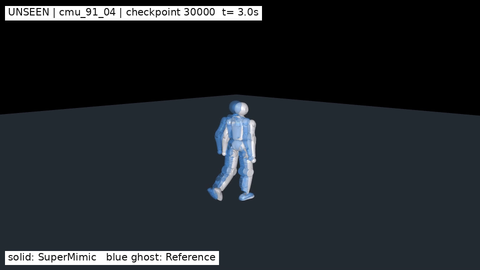

# supermimicplus

Lens110 全身 21 维动作跟踪：在线学习可微世界模型，用短时想象轨迹的反向传播更新策略，并用价值网络估计远期回报。项目包含分阶段训练、153 条训练动作、关键检查点、完整评测，以及一条未参与训练的随机动作演示。

[](docs/assets/unseen_cmu_91_04.mp4)

**[播放 18 秒未见动作演示](docs/assets/unseen_cmu_91_04.mp4)**：30000 轮模型，白色为策略控制的 Lens110，蓝色为参考。`cmu_91_04` 从 357 条排除训练集的候选中随机抽取，完整运行 18 秒，归一化回报 0.9188，未触发硬终止。保留真实全局位移，不把参考根位置对齐到机器人。

## 结果

训练于 2026-10-29 完成；RTX 5080 16 GB、4096 个环境、21 个受控关节。第二阶段 12000 → 30000 轮用时约 2 小时 47 分钟。全部训练阶段累计约 4 小时 37 分钟，不包含数据处理和评测。

| 30000 轮完整评测 | 完整执行 | 平均归一化回报 | 回报低于 0.82 |
|---|---:|---:|---:|
| 基础动作集 | 40/40 | 0.8477 | 8 |
| 扩充动作集 | 113/113 | 0.9204 | 5 |
| 全部训练动作 | 153/153 | 0.9014 | 13 |

原 40 条动作在 12000 轮的平均回报为 0.8340。全部动作按帧加权回报为 0.8569；短动作较多，所以同时保留按动作和按帧的口径。0/153 硬终止不等于零跟踪误差。以上为同仿真后端、每动作一次、无观测/动作噪声的完整参考回放，未包含扰动、跨仿真或实机验证。

[下载数据、模型和机器人资产](https://github.com/tulay-hub/supermimicplus/releases/tag/v0.1.0-30000)

## 安装与资源

从仓库根目录运行，推荐 Linux、Python 3.12、支持对应 PyTorch 的 NVIDIA 驱动。完整规模运行曾占用约 15.3 GB 显存。项目使用 MuJoCo 3.11、MuJoCo Warp、UniLab 1.5.1、UniSim 2.1.1；实际训练环境版本记录在 `reports/runtime_versions.json`。

```bash
git clone https://github.com/tulay-hub/supermimicplus.git
cd supermimicplus
python3.12 -m venv .venv
source .venv/bin/activate
python -m pip install --upgrade pip
# 先按显卡/驱动安装合适的 PyTorch，再安装项目。
python -m pip install -e . pytest ruff mypy pyright
python tools/fetch_release_assets.py
```

资源以 GitHub Release 附件分发，包含完整动作数据包、12000/30000 轮模型包和机器人资产包；下载器检查 SHA-256，并拒绝覆盖不同内容。代码仓库中的 `release-manifest.json` 记录每个附件的大小、校验和和内容。

## 分阶段训练

| 阶段 | 动作 | 轮次 | 更新内容 |
|---|---:|---:|---|
| 世界模型预训练 | 40 | 0–500 | 采集物理转移，更新世界模型；策略和价值网络尚不训练 |
| 基础联合训练 | 40 | 500–12000 | 持续更新世界模型、策略、价值网络 |
| 扩充联合训练 | 153 | 12000–30000 | 恢复完整检查点，加入 113 条动作，继续更新三个网络 |

以下启动命令用于新训练；附件已包含历史完成运行，脚本会拒绝覆盖。可先使用自定义的新目录；第二阶段通过 `SUPERMIMICPLUS_STAGE1_RUN` 指定第一阶段目录。

```bash
bash tools/train_lens110_lafan1.sh runs/my_stage1
SUPERMIMICPLUS_STAGE1_RUN=runs/my_stage1 \
  bash tools/train_lens110_expanded.sh runs/my_stage2
# 进程退出后恢复同一个第二阶段运行：
bash tools/train_lens110_expanded.sh runs/my_stage2 --resume
```

恢复完整的 `last.pt` 会保留三个网络、三个优化器和迭代计数；仿真状态与回放缓冲重新采集。编号 `ckpt_*.pt` 用于推理和评测，不能代替完整续训检查点。

## 评测与演示复现

```bash
supermimicplus-eval --backend mjwarp \
  --ckpt runs/lens110_lafan1_yahmp113_full21_30000_20261029/ckpt_030000.pt
MUJOCO_GL=egl python tools/preview_unseen.py
ffplay -autoexit outputs/unseen_cmu_91_04/unseen30000_cmu_91_04_meshes.mp4
```

未见动作脚本会先核对训练任务契约，仅替换参考文件及其哈希，并重新执行限位、速度、地面和自碰撞检查。测试参考不写回训练配置。

## 代码结构

```text
src/unisupermimic/
  conf/supermimic/                 # 算法、机器人、后端、153 动作配置
  scripts/train_supermimic.py      # 配置、运行目录、完整续训入口
  rl/algos/supermimic/             # replay、世界模型、策略、价值网络、BPTT
  tasks/motion_tracking/lens110/   # 21 关节、观测/目标、运动学和奖励契约
  tasks/motion_tracking/g1/supermimic/
                                  # 共享环境生命周期、动作、参考、评测和渲染
  sim2sim.py                      # 网络、机器人、动作库的严格契约检查
tools/                            # 训练、转换、审计、资源下载、未见动作播放
reports/                          # 两阶段日志、153 动作评测、未见动作与模型核对
docs/                             # 训练、架构、数据格式、演示视频
```

发行包名称与命令前缀是 `supermimicplus`。Python 内部包路径保留 `unisupermimic`，便于兼容已保存的配置和检查点；旧命令别名也保留。

详细说明：[分阶段训练](docs/TRAINING.md) · [算法和逻辑构成](docs/ARCHITECTURE.md) · [数据格式与打包内容](docs/DATASET.md) · [逐动作结果](reports/full153_eval_30000.json)。
