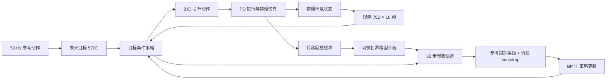

# 算法与逻辑构成

| 接口 | 维度与含义 |
|---|---|
| 单帧观测 | 75D，机器人运动状态、关节与上一动作等，具体拼接见任务 `obs()` |
| 历史 | 10 帧，共 750D |
| 未来目标 | 10 帧 × 57D = 570D |
| 策略潜变量 | 32D |
| 动作 | 21D，双腿 12、腰 1、双臂 8 |
| 状态 | 55D：根位置 3、根旋转四元数 4、根线速度 3、根角速度 3、关节角 21、关节速度 21 |
| 仿真参数 | 25D：摩擦 1、关节偏置 21、躯干质心偏移 3 |
| 世界模型输入 | 101D：根高度 1 + 朝向不变旋转特征 6 + 根坐标系线/角速度 6 + 关节角/速度 42 + 动作 21 + 仿真参数 25 |
| 世界模型输出 | 54D 增量：旋转用 3D 增量代替状态四元数 4D |

动作目标为 `q_target = q_default + joint_offset + alpha * action`，其中 alpha 从力矩上限和 PD 比例增益计算。腰与双臂参与同一策略优化。该实现的策略输出不是直接叠加到参考关节角的残差。

奖励包含身体位置、身体姿态、身体线速度、身体角速度、根位置和根姿态六项指数跟踪，以及动作变化和软关节限位惩罚。精确权重和指数误差尺度记录在任务配置的 `env.commands.motion.reward_cfg`，对应实现位于共享 `mdp.py`；修改奖励需要更新契约，不能沿用“完全相同训练条件”的结论。

`manager_terms.py` 管理参考相位、动作、上下文随机化、重置和统计；`env.py` 在自动重置前保存真实转移。`motion.py` 校验参考哈希并构造未来目标。`learner.py` 管理回放、世界模型优化、想象展开、策略和价值更新；`sim2sim.py` 检查加载条件。MuJoCo/mjwarp 是物理后端，世界模型是学习到的可微代理，两者各有职责。

注意区分 CSV 根四元数 **xyzw** 与 MuJoCo qpos 根四元数 **wxyz**。策略、重定向、播放器及真实机器人关节顺序都必须在各自消费边界核对。

## 奖励函数参数

每控制步奖励为 `0.02 × (四项身体跟踪 + 0.5 × 根位置跟踪 + 0.5 × 根姿态跟踪 + 动作变化惩罚 + 软限位惩罚)`。跟踪项使用 `exp(-平方误差 / std²)`。身体位置/姿态比较先移除参考与当前根的平面位置及朝向差；全局根位置和姿态另有独立奖励，所以需要同时观察姿态误差和全局漂移。

| 参数 | 本次训练值 |
|---|---:|
| `_target_` | `unisupermimic.tasks.motion_tracking.g1.supermimic.mdp.RewardCfg` |
| `body_pos_std` | `0.259344096364356` |
| `root_pos_std` | `0.259344096364356` |
| `body_linvel_std` | `0.86448032121452` |
| `term_height` | `0.21612008030363` |
